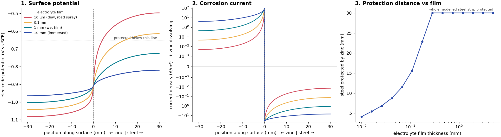

# galvanic-fem

[](https://github.com/CynthiaUkagha/galvanic-fem/actions/workflows/tests.yml)

**How far does zinc protect a scratch in galvanized steel? A small finite-element model, written from scratch and verified three ways.**



Car bodies use galvanized steel: a zinc coating that corrodes first to protect the steel. At a scratch or cut edge the steel is exposed, and protection depends on how far the zinc's current can reach through the water on the surface. That water is rarely a deep bath. It's usually a thin film from dew, condensation or road spray, and a thin film conducts poorly.

This model solves the electrolyte potential in a 2D cross-section, zinc on one side of the junction and bare steel on the other, with Tafel kinetics on each metal. It uses linear triangular finite elements and a damped Newton solver with a line search, in about 200 lines of Python (NumPy and SciPy).

## Result

| Electrolyte film | Steel protected by zinc |
|---|---|
| 10 µm (dew, road spray) | 4.1 mm |
| 0.1 mm | about 15 mm |
| ≥ 0.3 mm (wet film, immersion) | the whole 30 mm modelled |

**Engineering takeaway:** under the thin films typical of atmospheric exposure, zinc protects only a few millimetres of exposed steel. A wide scratch on a car panel in humid, salty conditions can corrode at its centre even though the coating sacrifices itself at the edges. That's why tests that only immerse samples can overstate cut-edge protection.

## Verification

A model is only useful if you can show it's solving the equations right. Each check below is a unit test.

| Check | Requirement | Result |
|---|---|---|
| **Charge balance:** zinc current out equals steel current in | < 1 part per million | worst 5 × 10⁻⁹ |
| **Hand-calculation limit:** in a near-perfect conductor the potential is uniform and must equal the classic mixed-potential answer | within 1 mV | 0.04 mV |
| **Mesh convergence:** refining the mesh 2× must barely change the answer, and the change must shrink | < 1% | 0.07% |
| **Physical trend:** a thinner film never protects more | monotonic | yes |

**A numerical lesson.** For 10–30 µm films the Newton solver stalled at a relative residual near 10⁻⁸, even with a line search. The cause was round-off error: such thin films make very flat elements and a poorly conditioned matrix, so the residual can't get any smaller. The answer was already stable to every digit reported. The solver now also stops when the potential update drops below 1 nV, and it records which criterion stopped it.

## Run it

```bash
git clone https://github.com/CynthiaUkagha/galvanic-fem.git
cd galvanic-fem
pip install -e .
python examples/demo.py
pytest
```

```python
from galvanicfem import Params, solve, protection_distance

sol = solve(thickness=1e-4)                       # 0.1 mm film, metres
print(protection_distance(sol) * 1e3, "mm of steel protected")
sol = solve(1e-4, p=Params(sigma=0.5))            # a more dilute electrolyte
```

## Assumptions and limitations

- **Kinetics:** Tafel laws with illustrative parameters in the range reported for zinc and steel in about 3.5% NaCl. They aren't fitted to one experiment, so set `Params` for your system.
- **Electrolyte:** uniform conductivity. There's no oxygen diffusion limit on the steel, no change in pH or film chemistry, and no corrosion products. Under very thin films oxygen transport speeds up, which this model leaves out.
- **Geometry:** 2D and steady state. Real cut edges are 3D and evolve as the zinc is consumed.
- **Scope:** full multiphysics (transport of species, moving boundaries, time dependence) needs a framework such as MOOSE. This repo is a transparent, verifiable baseline for that kind of model.

## Author

**Onyinye Ukagha**, materials scientist working on corrosion modelling, failure analysis, X-ray diffraction and electron microscopy.
[Website](https://cynthiaukagha.github.io) · [GitHub](https://github.com/CynthiaUkagha)

MIT License
